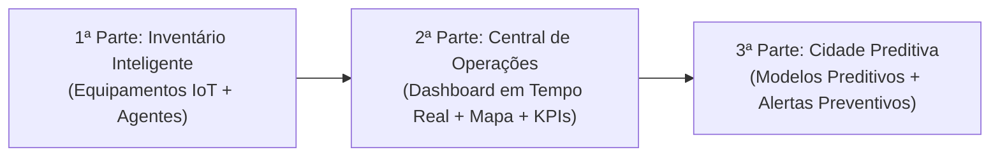

# Desafio Bônus: F.O.G.O. (Ferramenta Onisciente de Gestão e Operações)

> "Uma cidade que pensa à frente. Construa uma visão integrada da mobilidade urbana, transforme dados em decisões e mostre a PROMETHEUS o que uma boa solução é capaz de antecipar."

Esta skill serve como especificação, guia arquitetural e roteiro de implementação para o projeto **F.O.G.O.**, estruturado em três etapas fundamentais.

---

## 🎯 Visão Geral e Critérios de Sucesso

As soluções da Etapa Bônus são avaliadas com base em:
- **Resolução do problema proposto** e efetividade.
- **Qualidade técnica**, arquitetura limpa e desempenho.
- **Experiência de uso (UX/UI)**: clareza na visualização de dados espaciais e operacionais.
- **Criatividade e diferenciais**: capacidade de transformar dados brutos em decisões acionáveis para gestores e para a IA PROMETHEUS.
- **Transparência no uso de IA**: explicabilidade clara do que foi previsto, quais dados embasaram a previsão e como isso orienta a decisão operacional.

---

## 🏗️ Estrutura do Desafio em 3 Etapas

---

## 1ª Parte – Inventário Inteligente da Cidade

Catalogação e gestão dos equipamentos de apoio à segurança/trânsito e dos agentes operacionais.

### 1.1 Entidades Principais

#### Equipamentos IoT
- **Tipo de Equipamento**:
  - Radar de fiscalização (velocidade, avanço de semáforo, conversão/retorno proibido, etc.);
  - Câmera de videomonitoramento (resolução, visão noturna, colorida/P&B, streams RTSP/HLS);
  - Balança de pesagem dinâmica de caminhão;
  - Veículos autônomos de fiscalização de estacionamento rotativo;
  - Cancela automatizada e controle de acesso;
  - Veículos de transporte público/privado (táxi, mototáxi, transporte escolar);
  - Totem de autoatendimento para estacionamento rotativo;
  - Patinetes e bicicletas elétricas compartilhadas;
  - Viaturas e motos operacionais.
- **Identificação do Dispositivo**:
  - Número de série, marca, modelo e fabricante.
- **Localização / Base**:
  - CEP, logradouro/rua, bairro, cidade/UF;
  - Ponto de referência (ex.: "número 181", "oposto ao número 181", "KM 203", "em frente ao Mercado do Tio");
  - Coordenadas geográficas exatas (`latitude`, `longitude`).
- **Situação / Status Operacional**:
  - `ainda não instalado`, `operacional`, `mau funcionamento`, `em manutenção`, `desativado`, `furtado`.
- **Gestão de Manutenção**:
  - Necessidade de manutenção: `nenhuma`, `imediata` (corretiva por falha/mau funcionamento) ou `agendada/periódica` (preventiva);
  - Data e hora da próxima manutenção programada;
  - Histórico de ordens de serviço e intervenções técnicas.
- **Propriedades Específicas (Metadados Dinâmicos)**:
  - Câmeras: visão noturna (booleano), resolução (1080p, 4K), tipo de sensor, PTZ;
  - Radares: velocidade limite permitida (km/h), faixas monitoradas, tipo de infração fiscalizada;
  - Balanças: peso máximo tolerado, tolerância metrológica;
  - Totens / Cancelas: status de conectividade, estoque de papel/bobina.

#### Agentes em Campo
- Cadastro e telemetria de agentes de mobilidade e segurança:
  - Identificação: matrícula, nome, função (`Agente de Trânsito`, `Guarda Municipal`, `Policial Militar`);
  - Equipe / Lotação / Batalhão;
  - Meio de locomoção / Viatura associada (viatura 4 rodas, moto, patrulha a pé);
  - Status em tempo real (`em patrulha`, `em atendimento de ocorrência`, `em intervalo`, `fora de turno`);
  - Última posição GPS conhecida e timestamp.

---

## 2ª Parte – Central de Operações da Cidade

Visualização integrada e em tempo real para permitir que os gestores e PROMETHEUS monitorem a cidade.

### 2.1 Requisitos Obrigatórios
1. **Mapa Interativo Integrado**:
   - Plotagem de todos os equipamentos e agentes com iconografia distinta por categoria e tipo;
   - Cores e marcadores visuais que indiquem o status operacional (`operacional = verde`, `falha = vermelho`, `atenção/manutenção = amarelo`, `desativado/furtado = cinza/preto`);
   - Popups e drawers com detalhes completos ao clicar no elemento.
2. **Painel de Indicadores Gerais (KPIs)**:
   - Total de equipamentos cadastrados;
   - Equipamentos operacionais vs. indisponíveis;
   - Taxa percentual de disponibilidade da malha (SLA geral);
   - Quantidade de agentes ativos no turno e distribuição por força de segurança/trânsito.
3. **Filtros e Segmentação**:
   - Por tipo de equipamento, status operacional, bairro/região administrativa e órgão responsável.
4. **Destaque de Manutenção e Urgência**:
   - Visão rápida de equipamentos exigindo manutenção imediata ou com prazo de preventiva próximo do vencimento.
5. **Painel de Alertas Críticos**:
   - Alertas de anomalias (ex.: corte súbito de telemetria, suspeita de furto, velocidade anômala em lote de sensores, botão de emergência de agente acionado).
6. **Visão Consolidada por Região**:
   - Mapas de calor (Heatmaps) ou coropléticos indicando o índice de saúde operacional por bairro.

---

## 3ª Parte – Cidade Preditiva

Transformação de dados históricos e em tempo real em inteligência preditiva acionável para antecipar eventos futuros.

### 3.1 Linhas de Investigação e Modelagem Preditiva
- **Previsão de Gargalos e Pontos Críticos de Tráfego**:
  - Probabilidade de incidentes por dia da semana, faixa de horário, condições climáticas e eventos especiais (shows, jogos, chuva intensa).
- **Dimensionamento e Alocação Otimizada de Efetivo**:
  - Recomendações dinâmicas de despacho de agentes e viaturas para áreas com alta propensão a sinistros ou congestionamentos.
- **Predição de Falhas de Equipamentos (Manutenção Preditiva)**:
  - Detecção de desvios graduais na telemetria indicando iminência de quebra de radares, câmeras ou totens.
- **Índice de Risco Territorial Dinâmico (Score de Risco)**:
  - Combinação ponderada de histórico de acidentes, infrações detectadas, fluxo de veículos e cobertura de fiscalização por bairro/polígono.
- **Explicabilidade das Previsões (XAI)**:
  - Cada predição gerada pela plataforma deve responder explicitamente:
    1. *O que está sendo previsto?*
    2. *Quais parâmetros/features influenciaram a predição?*
    3. *Qual é a ação recomendada para a tomada de decisão operacional?*

---

## 🛠️ Stack Tecnológica Recomendada

- **Frontend / Dashboard**:
  - React + Vite ou Next.js;
  - Mapas: MapLibre GL, Leaflet ou Google Maps API;
  - Visualizações/Gráficos: ECharts, Recharts ou Chart.js;
  - UI Components: Tailwind CSS, Shadcn UI / Radix.
- **Backend / APIs**:
  - Node.js (NestJS / Express / Fastify) ou Python (FastAPI);
  - WebSocket / SSE para atualizações em tempo real de telemetria;
  - PostgreSQL com extensão **PostGIS** para consultas geoespaciais (`ST_DWithin`, `ST_Contains`).
- **Camada Preditiva / IA**:
  - Python (Scikit-Learn, LightGBM, Prophet, PyTorch) ou integração com modelos Gemini via function calling e raciocínio analítico estruturado.

---

## 📋 Checklist de Validação da Solução

- [ ] CRUD completo e flexível de equipamentos com propriedades dinâmicas por categoria.
- [ ] Cadastro e rastreamento de agentes de campo com vínculo a viaturas e órgãos.
- [ ] Dashboard com mapa interativo contendo ícones distintos e clustering para alta densidade.
- [ ] Filtros reativos por tipo, situação, região e órgão.
- [ ] Central de alertas e monitoramento de saúde dos equipamentos (manutenções imediatas vs preventivas).
- [ ] Módulo preditivo funcional com explicações visíveis sobre variáveis de entrada e impacto na decisão.
- [ ] Documentação clara do projeto demonstrando o domínio da solução e menção a eventuais IAs utilizadas no desenvolvimento.

